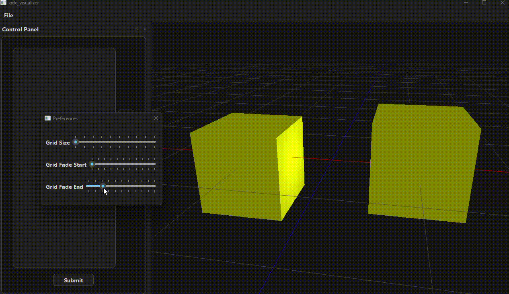

# Ordinary Differential Equations Visualizer
This program visualizes ordinary differential equations in real time in up to 3 dimensions. The equations can be given by the user at runtime, evaluated and visualized immediately. The user can navigate the simulation scene that's rendered by an OpenGL context.



## Cloning
To clone this project use:
```
git clone --recurse-submodules https://github.com/Ezic04/ode_visualizer.git
```

## Building
Before building you'll need to create a `toolchain.cmake` file in the root direcory of the project and add this line:
```
SET(QT_DIR "/path/to/qt/dir" CACHE STRING "Qt installation directory")
```

Then you can call:
```
cmake --preset build-debug
cmake --build build/debug
```
or
```
cmake --preset build-release
cmake --build build/release
```
depending on which version you'd like to compile.
